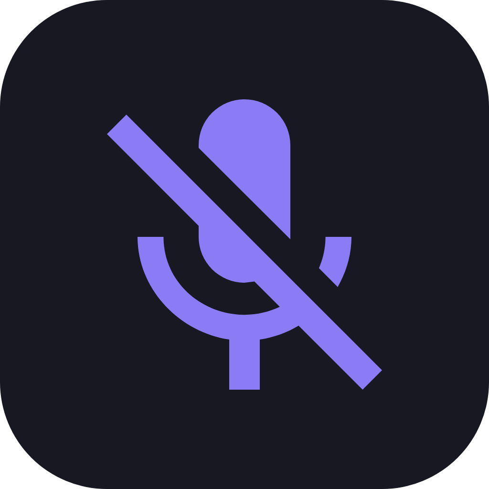

  

<h1 align="center">MuteGuard</h1>

  A small, event-driven microphone mute utility for Windows meetings.

MuteGuard is a deliberately subtractive fork of
[silence!](https://github.com/vertopolkaLF/silence). It keeps the Rust,
Dioxus, Core Audio, global-hotkey, tray, and native-overlay foundation while
removing unrelated audio management and background monitoring.

## What it does

- Toggles, mutes, or unmutes the default communications microphone (falling
  back to the console default), a selected capture device, or every active
  capture endpoint.
- Supports multiple global keyboard and mouse hotkeys, including single keys,
  modifier-only bindings and arbitrary simultaneous keyboard chords such as
  `A+B` or `Win+Shift+A`, without requiring `Ctrl`.
- Gives each hotkey an explicit Toggle mute, Mute, or Unmute action and can
  optionally ignore additional modifier keys for an individual binding.
- Shows muted/unmuted state in the tray and in a configurable click-through
  overlay.
- Offers multi-monitor overlay selection, a nine-anchor position picker, scale,
  icon/dot/text, exact editable overlay/tray icon color, opacity, background,
  border, and temporary after-toggle visibility settings. Overlay scale 100%
  uses the new compact baseline (85% of the previous geometry).
- Uses a `#131313` dark overlay background and provides a unified MuteGuard
  color studio with live HSV tuning, RGB feedback, exact HEX validation and
  presets. Preview movement stays local and configuration is saved on commit.
- Lets the Settings interface follow the Windows accent or use a custom accent
  selected in General.
- Shows one synchronized overlay on every selected monitor and keeps each one
  inside that monitor's usable work area, clear of the taskbar and at least 10
  px from every available screen edge.
- Can start with Windows and mute once the default meeting microphone becomes
  available during background-process startup.
- Rebinds immediately when Windows changes the default communications
  microphone and can notify when that endpoint changes or becomes unavailable.
- Provides optional mute/unmute feedback tones, with separate built-in or
  replaceable custom 16-bit PCM WAV sounds up to five seconds long.
- Lets you select a microphone and build an ordered chain of high-pass,
  RNNoise, gate, expander, de-esser, three-band EQ, compressor, and limiter
  modules through the experimental Microphone effects tab.
- Includes a local Diagnostics page with refreshable runtime status and a
  credential-free support report that can be copied to the clipboard.
- Can check the public GitHub release feed anonymously at most once per day,
  notify when a newer stable version exists, and open the official x64
  installer only after an explicit click.
- Keeps Settings in a separate process so closing it releases WebView
  resources.

Left-clicking the tray icon opens Settings. Its right-click menu can mute or
unmute the microphone, open Settings, or exit MuteGuard.

## Microphone effects

Activate MuteGuard APO for the selected microphone, then enable the modules
you need. Each module has editable values and up/down buttons that change
the actual processing order. Reopen recording apps after changing the chain.
Existing settings are preserved; newly added modules start disabled.

These are starting values, not universal voice presets:

| Module | Initial values |
| --- | --- |
| High-pass | 80 Hz, 12 dB/octave; 24 dB/octave also available |
| RNNoise | 100% strength; requires 48 kHz |
| Noise gate | −45 dB, 100 ms hold, 150 ms release |
| Downward expander | −40 dB, 2:1, 10 ms attack, 50 ms release; RMS detector |
| De-esser | 6 kHz, −30 dB, 4:1, 2 ms attack, 60 ms release, maximum 6 dB reduction |
| EQ | Three bell bands at 150 Hz, 3 kHz, and 8 kHz; 0 dB gain, Q 1; all editable |
| Compressor | −18 dB, 2.5:1, 10 ms attack, 150 ms release |
| Limiter | −6 dB ceiling, 60 ms release |

The expander and limiter values follow the [OBS expander](https://obsproject.com/kb/expander-filter)
and [limiter](https://obsproject.com/kb/limiter-filter) defaults. The high-pass
is close to the 75 Hz starting point described by [RØDE](https://help.rode.com/hc/en-us/articles/17366565342863-How-to-Use-R%C3%98DE-Audio-Processing-Controls).
The de-esser uses [frequency-selective sidechain compression](https://help.rode.com/hc/en-us/articles/7390770430351-How-the-R%C3%98DECaster-Pro-Duo-De-Esser-Works);
its threshold and reduction are conservative choices to tune by ear, not a
manufacturer preset. Gate and compressor defaults retain the original
MuteGuard tuning. EQ starts flat because the useful cuts and boosts depend
on the microphone and voice.

Usually choose either gate or expander. Keep the limiter last if you want it
to protect the final output; it limits sample peaks, not inter-sample peaks,
and cannot fix clipping that happened in the microphone. RNNoise adds about
20 ms of latency; the other modules add no buffering.

## Runtime model

Core Audio is the state authority:

    user action
      -> GetMute
      -> SetMute
      -> IAudioEndpointVolumeCallback::OnNotify
      -> GetMute
      -> tray + overlay

MuteGuard does not optimistically update its UI after SetMute. A Core Audio
notification causes the authoritative state read. Endpoint notifications
rebind that callback when the Windows default capture endpoint changes.

For an all-microphones toggle, the default communications microphone determines the target
direction and active capture endpoints are enumerated only for that user
action. Explicit Mute and Unmute actions skip endpoints that already have the
requested state.

There is no recurring configuration, device, session, process, microphone-use,
gamepad, or inactivity polling. Core Audio device changes remain event-driven.
When update checks are enabled, one short anonymous request to the public
GitHub Releases API is allowed at most once per day; Check now is the only
manual bypass. Timers are limited to
finite overlay transitions, temporary overlay
dismissal, startup-mute retry, release reconciliation for global hotkeys, a
short event-driven Core Audio debounce, and tray restoration after an Explorer
failure.

## Configuration

Configuration is stored at:

    %APPDATA%\MuteGuard\config.json

Custom feedback sounds replace stable files below:

    %APPDATA%\MuteGuard\sounds

The non-sensitive result of the last update check is cached at:

    %APPDATA%\MuteGuard\update-cache.json

On first use, MuteGuard can read the previous
%APPDATA%\SilenceV2\config.json. Compatible hotkeys, their Toggle mute, Mute,
or Unmute actions, direct capture device targets, and settings are migrated;
gamepad bindings, sounds, and other removed features are discarded.

Saving Settings sends an explicit native message to the background process.
The background process does not watch the file modification time.

If the configuration is invalid, Settings offers an explicit recovery action.
The invalid file is preserved as a timestamped backup before defaults are
written. Audio, configuration, process-launch, and notification-registration
errors are also surfaced through the Settings window or a native tray alert.

## Build

For an application-only Windows build, use Rust 1.98, the
`x86_64-pc-windows-msvc` target, and Dioxus CLI:

    dx build --platform windows --release --target x86_64-pc-windows-msvc

This builds the app alone; it does not produce an installer or the microphone APO.

### Complete Windows x64 package

To build the complete Windows x64 package, use Windows with Docker Desktop,
Visual Studio Build Tools and the Windows SDK. The checked-in Docker image
contains Rust 1.98, the Windows GNU target and linker, Dioxus CLI 0.7.6, and
NSIS:

    docker build --file docker/Dockerfile.windows-gnu --tag muteguard-builder:rust-1.98-dx-0.7.6 .

Network access is needed only while creating the image. The package build
uses `--network none` after the image and named Cargo/target volumes exist.

Dioxus CLI 0.7.6 currently passes MSVC linker flags when `dx build --windows`
is combined with the GNU target. The cross-build therefore uses the desktop
platform and provides the MinGW resource tools explicitly. `build.rs` also
embeds the Windows icon and version resource in the same Dioxus-built
executable that references the packaged assets.

The complete Windows x64 package pipeline is:

    .\build-docker.ps1

It builds the microphone APO, performs an offline Dioxus release build,
assembles the portable directory with the WebView2 loader and license, creates
the portable ZIP, and compiles the current-user NSIS installer and its ZIP.
The outputs are in `dist/<version>`. The installer detects the Microsoft Edge
WebView2 Runtime and offers the official Evergreen bootstrapper when it is
absent.
Mute hotkeys, tray controls, and the native overlay do not depend on WebView2;
only Settings does.

The x64 package also includes the experimental MuteGuard microphone APO. Open
**Microphone effects** to select a microphone, activate the effect with an
administrator prompt, and adjust RNNoise strength, gate, and compressor values.
Close and reopen recording apps after activation or parameter changes. The APO
is currently unsigned and is intended for local testing; the microphone's
current registry state is backed up. **Deactivate MuteGuard APO** only
disconnects MuteGuard from the microphone; it does not reconnect an older effect.
Deactivate it before uninstalling MuteGuard.

## Scope

MuteGuard intentionally has no microphone gain control, output/input switching,
per-process microphone-use detection, hold actions, inactivity automation, or
controller support.

## Attribution and license

MuteGuard is based on silence! by vertopolkaLF and retains the upstream Apache
License 2.0. See [LICENSE](LICENSE) and
[THIRD_PARTY_NOTICES.md](THIRD_PARTY_NOTICES.md).
